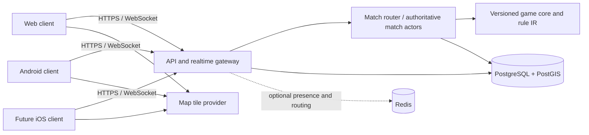

# HUNTZONE — Technical architecture

## Recommended starting stack

- **Web:** TypeScript with React and a server-rendered/meta-framework chosen when the first UI slice is approved. Keep the game client as a thin renderer and intent sender.
- **Backend:** TypeScript on a supported Node.js LTS runtime, with an HTTP API and WebSocket gateway. Keep framework choice open until a short implementation spike compares a minimal Fastify-based service with NestJS conventions.
- **Game core:** a framework-independent TypeScript package containing typed match state, commands, reducers, validators and versioned rule IR. No browser APIs, database calls or framework imports in the core.
- **Persistence:** PostgreSQL; add PostGIS for spatial boundaries, safe zones and indexed spatial queries. Store match configuration and durable outcomes, not a default raw location trail.
- **Realtime:** WebSockets for authenticated commands and authorized state updates. Use a connection/session layer that can reconnect and obtain a fresh snapshot.
- **Android:** native Kotlin client for location collection and foreground service lifecycle. Reuse the web/backend API and rule protocol; do not use a web page or PWA for background tracking.
- **Maps:** MapLibre-compatible client rendering with a contracted tile/geocoding provider selected after coverage, attribution, licensing, privacy, offline and cost review. Keep provider-specific code behind an adapter.
- **Operations:** containerized services, managed PostgreSQL, metrics/logging and backups. Start in one region. Introduce Redis for presence/pub-sub or match routing when measured load requires it; do not make it the source of durable match truth.

This is a recommended, testable direction, not a commitment to a specific vendor or hosting plan. Estimate peak concurrent matches and location-message rate before selecting service sizes or budgets.

## Logical components

## Authority and realtime protocol

Clients send intent: join, ready, activate ability, request capture, submit task result, leave, or upload a location observation with timestamp, accuracy and sequence metadata. The server authenticates, authorizes, rate-limits and validates every command against current state and mode version. It computes captures, score, timers, events and outcomes. Client state is presentation only.

Use a versioned protocol with request IDs, monotonically increasing per-session sequence numbers, server timestamps, idempotency for retried commands, acknowledgements and structured errors. On reconnect, clients present a session credential and last acknowledged revision; server either sends a bounded delta or a fresh privacy-filtered snapshot. Stale/duplicate location samples are rejected or marked; they never move authoritative state backward.

For 3–30 players, one logical match actor owns a match's mutable state at a time. Route a match consistently to its owner. Persist lifecycle transitions, mode version and outcome; checkpoint enough durable state for recovery. Do not assume an in-memory actor survives a process crash. A later horizontal deployment can partition matches across workers and add a routing/pub-sub layer while preserving the core contract.

## Scaling and failure behavior

Begin with one region and a small number of service instances appropriate to measured pilot load. Isolate match processing from HTTP request handling. Track active sessions, incoming location rate, fan-out, actor lag, reconnects, DB pressure and message delivery latency. Apply per-user and per-match quotas, adaptive update cadence, bounded queues and backpressure. Drop obsolete location observations before dropping lifecycle or safety-relevant commands.

When a gateway restarts, reconnect to the match owner. When a match worker fails, recover from a durable checkpoint and event sequence where possible; otherwise pause and provide an explicit recovery/cancel outcome rather than inventing a result. If the database is unavailable, do not start a match that cannot persist its required lifecycle. If realtime delivery lags, show stale-state age and pause rules that would otherwise make unfair captures.

### Durable match state and recovery

PostgreSQL is the only durable match-state store in the MVP. Do not add a message broker, event-stream cluster or Redis dependency for persistence. A single match actor owns live state; its in-memory state is a cache of the last committed checkpoint plus subsequent committed events. With one match-owning process, process-local ownership is sufficient. Before introducing a second match worker, add per-match database leases/fencing revisions so only one worker can advance a match revision.

Every accepted state-changing command is validated and applied serially. In one database transaction, append the resulting domain event(s), advance the match revision and update a checkpoint when required. Commit before acknowledging the command or publishing resulting state. Use a checkpoint at match start, every 15 seconds while active or after 50 committed state transitions, whichever happens first, and immediately after lifecycle, role, capture/elimination, mission outcome, ability/zone spawn, or any transition whose loss could change fairness. These are starting operational limits to validate under pilot load; tune before increasing write frequency. Location samples themselves are not events and do not trigger writes.

Checkpoint payload includes match/mode/engine versions, phase, roster IDs and virtual states, private role assignments, team memberships, score/objective progress, active missions and their state, ability inventory, cooldown/deadline timestamps, current zone/event IDs and expiry timestamps, deterministic random seed/counter, player command-sequence high-water marks, and last committed event revision. Do not include latitude, longitude, route geometry, map viewport or any location-derived precise value. The snapshot is backend-only; construct a separate authorization-filtered projection per participant.

The durable event log contains bounded, versioned game outcomes and lifecycle transitions (for example role assigned, capture resolved, score awarded, mission completed, zone activated, match paused/ended). It excludes GPS samples and raw capture distances/coordinates. Include match revision, event type/version, actor/target IDs where needed, server timestamp, command idempotency key and minimal rule/config version references. Avoid duplicating personal data. A checkpoint and replay from it must yield the same virtual state for the same engine version and committed events.

On process restart, establish exclusive match ownership (local ownership for the single-worker MVP; a database lease with a higher fencing revision once multiple workers are introduced); load the newest valid checkpoint; replay later committed events in revision order; restore timers from absolute server deadlines; mark expired cooldowns/events complete; then reopen commands and send reconnecting clients a fresh filtered snapshot. A timer never restarts from its original duration. If replay detects a gap, unsupported engine version or invalid state, keep the match paused and move it to a recoverable/cancelled state; never guess an outcome. Match creation pins immutable mode and engine versions.

Accepted state transitions are at-least-once at the transport boundary and idempotent in the domain. Each mutating command has a `commandId`; persist a uniqueness constraint for `(match_id, actor_id, command_id)` with the committed result revision. A retry returns the original result and does not reapply effects. Client sequence numbers and server-issued session epochs reject stale/replayed messages. Events have unique `(match_id, revision)`; clients deduplicate by revision. Publish only after commit. If the process dies after commit but before send, reconnecting clients request events after their last revision or receive a fresh snapshot.

**Database unavailable:** reject new match starts and state-changing commands that cannot be committed; do not acknowledge uncommitted changes. Existing actors stop location-dependent adjudication and all match actions, show paused/server-unavailable state, and discard exact GPS samples. If the actor process survives, it records the outage start in volatile monotonic time; after the database returns it first commits a recovery-pause event and shifts absolute match deadlines by the observed pause duration, then requires fresh GPS before resuming. This preserves timer fairness without a write during the outage. If the actor also crashes and the outage duration cannot be proven, restore the last committed state but keep the match paused for host/operator resolution or cancel without a winner; never infer missing pause time or adjudicate from old GPS. If recovery cannot meet the operator-configured window, cancel with no invented result.

**Match process unavailable:** the supervisor restarts it. While recovery runs, clients see reconnecting/paused, not active state. A restore exercise must kill a worker at each commit/publish boundary and verify no duplicate capture, score or mission award.

**Database process/service crash:** managed-service failover and backup restore must match the selected deployment's documented guarantees. A transaction acknowledged by the database is the recovery boundary; if the deployment loses acknowledged commits, affected matches are cancelled and recorded as an operational incident. Backups are for disaster recovery, not the normal per-match crash path. Set measurable RPO/RTO only after selecting a service and running recovery exercises.

## Security boundaries

Browser/app clients are untrusted. API gateway enforces identity, match membership and message size/rate limits. Match actors enforce game authorization. Database credentials are server-only and least-privileged. Location access is filtered per recipient and mode. Mode IR is validated and resource-bounded. Administrative moderation is separately authorized and audited. See [security and privacy](SECURITY-AND-PRIVACY.md).

## Deployment and cost controls

Keep the initial deployment small and observable: one application service, managed relational database with backups, and a tile provider selected under an explicit request budget. Avoid microservices, Kubernetes, a dedicated event-stream platform and multi-region state until load or availability data justify them. Model costs from concurrent players, location frequency, WebSocket egress, tile requests, database retention and support/moderation burden. Set alert budgets and usage limits before public launch.

## Architecture checks before implementation

1. Prototype location update throughput, fan-out and reconnect behavior for 30-player matches.
2. Establish a target location cadence, accuracy policy and sample-expiry rule from field tests.
3. Prove match recovery across worker restart with no client authority.
4. Validate the mode IR's determinism, limits and migration/version policy.
5. Choose a map provider with current terms and total-cost estimates.
6. Confirm the web and native clients can use one protocol without leaking exact positions.
